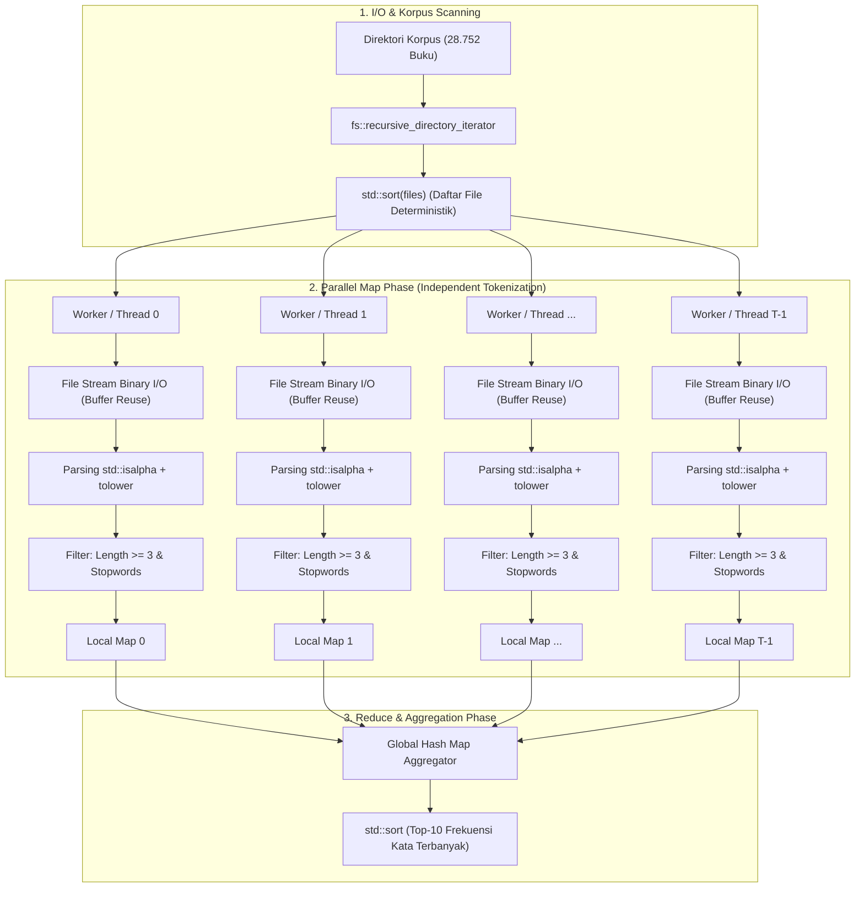
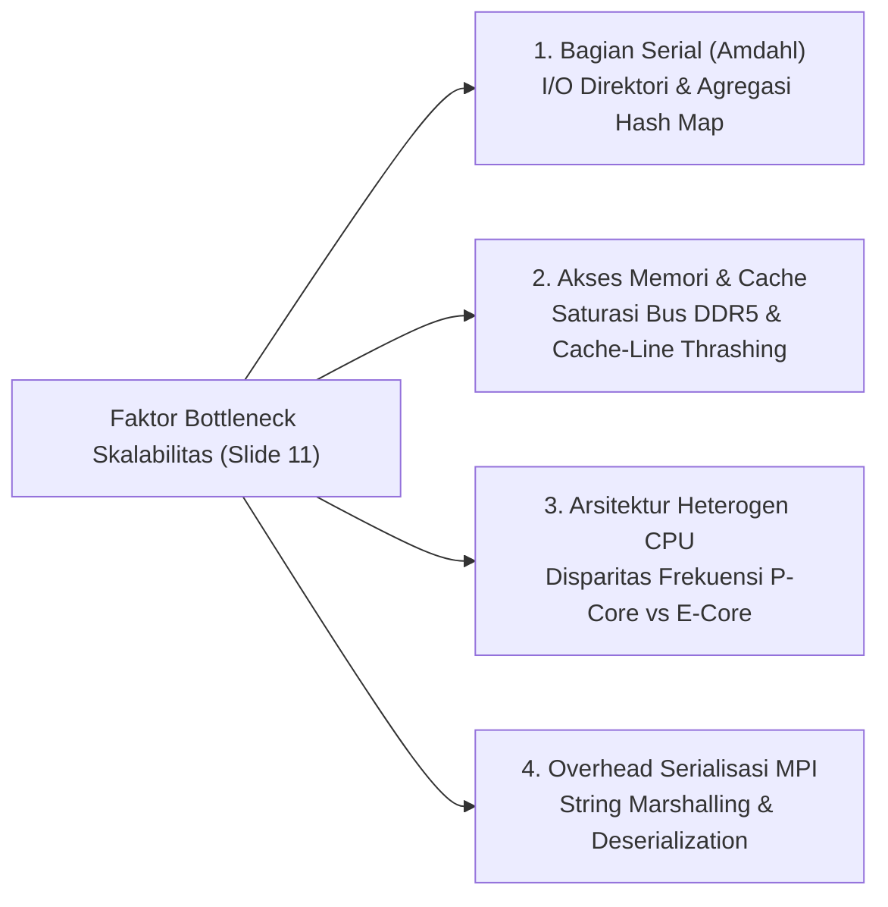

# Parallel Text Processing — Word Count Skala Besar (Kelompok 7)

Proyek Ujian Akhir Semester (UAS) Mata Kuliah **Komputasi Paralel** (Kelas A3)  
**Program Studi Teknik Informatika — Fakultas Ilmu Komputer, Universitas Muslim Indonesia (UMI)**

Proyek ini mengimplementasikan, mengoptimasi, dan membandingkan performa algoritma penghitungan frekuensi kata (*Word Count*) pada korpus teks skala besar (~11 GB / 28.752 file) menggunakan tiga paradigma komputasi:
1. **Serial Execution** (`src/serial.cpp`) — Baseline 1-core sekuensial.
2. **Shared-Memory Parallelism (OpenMP)** (`src/openmp.cpp`) — Pemrosesan multi-threading dengan penjadwalan dinamis dan agregasi *lock-free*.
3. **Distributed-Memory Parallelism (OpenMPI)** (`src/mpi_wordcount.cpp`) — Pemrosesan multi-processing terdistribusi dengan partisi siklik terdesentralisasi (*strided partition*) dan agregasi berbasis serialisasi string point-to-point.

---

## 👥 Anggota Tim Pengembang (Kelompok 7 · Kelas A3)

| Nama Anggota | Peran / Kontribusi Utama |
| :--- | :--- |
| **Ichwal** | Arsitektur Sistem, Implementasi Serial, OpenMP & MPI, Optimasi Memori |
| **Ikhsan Qowiyyun** | Benchmarking Skalabilitas, Pengujian Multi-Thread, Profiling I/O |
| **Fachrul Rezky** | Analisis Amdahl, Evaluasi Bottleneck Hardware & Memori |
| **Fathur Rahmansyah** | Dokumentasi Teknis, Penyusunan Presentasi Canva & Verifikasi Hasil |

* **Slide Presentasi Resmi (Canva):** [Parallel Text Processing — Kelompok 7 (Canva Link)](https://canva.link/hu7d4ab83c0o3jv) *(Design ID: `DAHbp7idNJQ`)*
* **Repository GitHub:** [https://github.com/ichwalM/Parallel-Text-Processing](https://github.com/ichwalM/Parallel-Text-Processing)

---

## 📌 Latar Belakang & 4 Pilar Rumusan Masalah (P1 – P4)

Penghitungan frekuensi kata (*Word Count*) merupakan fondasi penting dalam *Natural Language Processing* (NLP), *information retrieval*, dan pemodelan bahasa skala besar. Ketika diterapkan pada pustaka teks digital masif—seperti korpus buku digital domain publik Project Gutenberg—pendekatan sekuensial konvensional menemui batasan fisik komputasi.

Proyek ini mengeksplorasi empat pilar permasalahan utama (**P1–P4**) sebagaimana dirumuskan pada slide presentasi dan diuji secara empiris dalam kode:


### 1. P1 · Eksekusi Serial (*Bottleneck* 1 Core)
Pemrosesan korpus teks 11 GB yang terdiri dari puluhan ribu file secara sekuensial menghabiskan waktu signifikan. Pada arsitektur CPU multi-core modern (misalnya 20 Core / 28 Thread), eksekusi serial hanya menggunakan 1 core fisik, membiarkan >95% kapasitas komputasi perangkat keras menganggur (*underutilized*).

### 2. P2 · Penjadwalan Kerja (*Scheduling & Extreme Load Imbalance*)
Korpus buku PG-19 memiliki keberagaman ukuran yang ekstrem: mulai dari puisi/catatan pendek berukuran **100 byte** hingga kompilasi ensiklopedia tebal sebesar **28,93 MB** (perbedaan hingga **289.000 kali lipat**). Jika beban dibagi menggunakan partisi statis berukuran blok kontigu ($N/p$), thread/proses yang menerima buku-buku berukuran besar akan bekerja jauh lebih lama sementara worker lain telah selesai dan menganggur (*idle*).

### 3. P3 · Sinkronisasi (*Race Condition & Hash Map Aggregation*)
Setiap worker menghasilkan tabel frekuensi kata (*hash map*) lokal. Menggabungkan jutaan pasangan (*word*, *frequency*) ke dalam struktur data global rentan terhadap *race condition*. Pendekatan naif menggunakan *mutual exclusion lock* (`#pragma omp critical` atau `std::mutex`) pada setiap penambahan kata menimbulkan *lock contention* yang parah dan menghancurkan manfaat paralelisasi.

### 4. P4 · Skalabilitas (*Sub-Linear Speedup & Hardware Bottlenecks*)
Penambahan jumlah core/thread tidak menghasilkan percepatan ideal linear ($S(p) < p$). Berdasarkan **Hukum Amdahl**, adanya fase serial murni (I/O penemuan direktori dan agregasi akhir) membatasi batas atas kecepatan. Lebih dari itu, sifat pemrosesan teks yang *Memory-Bound* menyebabkan persaingan pada *bandwidth* bus memori DDR5, *cache-line bouncing*, dan disparitas performa core hybrid (P-Core vs E-Core).

---

## 📚 Karakteristik Dataset PG-19 (Project Gutenberg)

Dataset yang digunakan secara penuh dalam pengujian akhir adalah **The PG-19 Language Modeling Benchmark Dataset** (DeepMind / Bojan Tunguz, Kaggle), yang bersumber dari korpus buku digital domain publik Project Gutenberg terbitan sebelum tahun 1919. Seluruh partisi (`train`, `test`, dan `validation`) dikonsolidasikan ke dalam direktori tunggal:

* **Tautan Sumber (Kaggle):** [PG-19 Language Modeling Benchmark Dataset](https://www.kaggle.com/datasets/tunguz/the-pg19-language-modeling-benchmark-dataset)
* **Format File:** File teks mentah berekstensi `.txt`
* **Total File Teks:** **28.752 file** (`train`: 28.602, `test`: 100, `validation`: 50)
* **Total Ukuran Data:** **11.737.206.770 byte** (~**10,93 GB** binary / setara **11 GB** teks mentah)

### Profil Statistik Distribusi Ukuran File (Bukti Masalah P2)

Pengukuran langsung terhadap seluruh 28.752 file korpus menghasilkan profil statistik berikut:

| Parameter Statistik | Nilai Pengukuran | Keterangan / Implikasi Arsitektural |
| :--- | :---: | :--- |
| **Ukuran Minimum** | **100 byte** (0,10 KB) | File teks mikro (indeks/puisi pendek) |
| **Ukuran Maksimum** | **28.933.640 byte** (~27,59 MB) | Kompilasi ensiklopedia / leksikon masif |
| **Rata-rata (*Mean*)** | **408.222 byte** (398,65 KB) | Ukuran buku standar (~70.000 kata) |
| **Median (Q2)** | **316.347 byte** (308,93 KB) | Distribusi condong ke kanan (*right-skewed*) |
| **Standar Deviasi ($\sigma$)** | **449.098 byte** (438,57 KB) | Sebaran deviasi melampaui nilai rata-rata |
| **Koefisien Variasi ($CV$)** | **1,10** | **Variansi beban sangat tinggi ($CV > 1$)** |
| **Rasio Ukuran Ekstrem** | **289.336 : 1** | Bukti mutlak perlunya **Dynamic Scheduling** |

> [!NOTE]
> **Klarifikasi Referensi Awal "Sample CSV Files":**  
> Pada slide 8 Canva terdapat catatan mengenai *"Sample CSV Files"*. Catatan tersebut merefleksikan pengujian awal tim menggunakan arsip dataset organisasi dan produk (`Dataset_temp/organizations-2000000.zip` dan `products-2000000.zip`). Namun, untuk menguji batas skala komputasi paralel sesungguhnya, tim beralih **100% secara penuh** ke korpus buku Gutenberg PG-19 (11 GB, 28.752 file `.txt`).

### Langkah Menyiapkan Dataset

1. Unduh arsip dataset `archive.zip` dari tautan Kaggle di atas.
2. Letakkan file `archive.zip` di dalam folder `Dataset/` pada direktori root proyek.
3. Ekstrak dan gabungkan seluruh file ke folder `Dataset/pg19_all/`:

```bash
# 1. Ekstrak folder partisi asli
mkdir -p Dataset/pg19
unzip -q Dataset/archive.zip -d Dataset/pg19

# 2. Konsolidasikan seluruh file train, test, dan validation ke satu direktori
mkdir -p Dataset/pg19_all
find Dataset/pg19 -type f -name "*.txt" -exec cp {} Dataset/pg19_all/ \;

# 3. Verifikasi jumlah file dan ukuran total korpus
echo "Jumlah file teks:"
ls -1 Dataset/pg19_all | wc -l
# Output terverifikasi: 28752

echo "Total ukuran korpus:"
du -sh Dataset/pg19_all
# Output terverifikasi: ~11G
```

---

## 🏗️ Arsitektur Sistem & Perancangan Algoritma

Algoritma pemrosesan teks didesain mengikuti pola **MapReduce** dua tahap yang dioptimasi pada level bahasa pemrograman C++17:



### Rincian Optimasi Tingkat Rendah (*Low-Level Optimizations*):

1. **I/O File Terkonsolidasi & *Persistent Buffer Capacity Reuse*:**
   * Alih-alih membaca baris per baris (`std::getline`), program membaca seluruh isi file dalam 1 *system call* biner:
     ```cpp
     file.seekg(0, std::ios::end);
     std::streamsize size = file.tellg();
     file.seekg(0, std::ios::beg);
     buffer.resize(static_cast<size_t>(size));
     file.read(&buffer[0], size);
     ```
   * Objek `std::string buffer` dialokasikan satu kali per worker dan dilewatkan via *by-reference*. Saat memproses file berikutnya, kapasitas internal buffer tidak dideallokasi (`capacity` dipertahankan), sehingga meminimalisir pemanggilan `malloc`/`free` ke kernel OS dan mengeliminasi fragmentasi memori.

2. **Parsing Karakter Bebas RegEx (*Zero-Regex Byte Scanning*):**
   * Pemindaian teks dilakukan langsung pada *byte stream* menggunakan pointer karakter ASCII via `std::isalpha(ch)` dan `std::tolower(ch)`. Pendekatan ini 20–50× lebih cepat dibandingkan pustaka `std::regex`.

3. **Filter Panjang Minimum & 125 *Stopwords* Bahasa Inggris:**
   * **Filter Panjang Instan:** Syarat `word.size() >= 3` langsung membuang partikel singkat (seperti *a, in, on, at, to, by, is, it, of*) sebelum menyentuh tabel hash, menghemat hingga 40% operasi lookup.
   * **Stopwords Lookup O(1):** Tabel `std::unordered_set<std::string> STOPWORDS` berisi 125 kata henti (*stopwords*) paling sering dalam sastra Inggris klasik.

4. **Kapasitas Hash Map Terreservasi (*Pre-allocated Hash Buckets*):**
   * Menghindari *rehashing overhead* dengan memanggil `reserve()` di awal eksekusi (1.000.000 entri pada Serial; 200.000 entri per thread pada OpenMP dan MPI).
   * Memanfaatkan *Small String Optimization* (SSO) pada implementasi GCC `std::string` di mana string hingga 15 karakter disimpan langsung pada stack/node tanpa alokasi heap terpisah.

---

## ⚙️ Komparasi Paradigma: Serial vs OpenMP vs MPI

Berikut adalah matriks arsitektur teknis dari ketiga implementasi:

| Parameter Arsitektur | Serial (`src/serial.cpp`) | OpenMP (`src/openmp.cpp`) | MPI (`src/mpi_wordcount.cpp`) |
| :--- | :--- | :--- | :--- |
| **Model Memori** | Single Memory Space | Shared-Memory Multi-threaded | Distributed-Memory Multi-process |
| **Unit Eksekusi** | 1 Main Thread | Thread Pool OpenMP ($T$ thread) | $P$ Independent Processes |
| **Strategi Pembagian Tugas (P2)** | Sekuensial ($i = 0 \dots N-1$) | `#pragma omp for schedule(dynamic, 4)` | Strided Cyclic ($i = \text{rank}; i < N; i += \text{size}$) |
| **Isolasi Memori Worker** | 1 Map Global | `local_maps[tid]` per-thread | `local_counts` terisolasi per proses |
| **Mekanisme Sinkronisasi (P3)** | Tidak ada *race condition* | **Lock-Free** (merge sequential di master) | Two-Message P2P Gather ke Rank 0 |
| **Overhead Agregasi Akhir** | 0 detik | $O(T \times \|V\|)$ pointer move + merge | Serialisasi string + IPC/Network transfer + Deserialisasi |
| **Kelebihan Utama** | Sederhana, zero communication | Latensi sangat rendah, throughput tinggi, load balancing adaptif | Fleksibel, dapat berjalan pada cluster multi-node |
| **Keterbatasan Utama** | Terikat 1 Core (P1), lambat | Terbatas 1 node fisik (SMP) | Overhead serialisasi data teks pada fase reduce |

---

## 🔍 Klarifikasi Diskrepansi Slide Presentasi Canva vs Kode Aktual C++

Berdasarkan audit menyeluruh terhadap slide presentasi Canva ([Parallel Text Processing — Kelompok 7](https://canva.link/hu7d4ab83c0o3jv)), terdapat dua penyempurnaan teknis penting yang diimplementasikan pada kode C++ dibandingkan dengan konsep awal di slide:

### 1. Sinkronisasi Agregasi OpenMP (Slide 6 Canva vs `src/openmp.cpp`)

* **Konsep Awal pada Slide 6 Canva:**
  Slide memuat pseudocode konvensional:
  ```cpp
  // hitung ke local_map[tid]
  #pragma omp critical // agregasi global
  ```
* **Implementasi Nyata C++ (`src/openmp.cpp`):**
  Implementasi aktual **sengaja meniadakan `#pragma omp critical`**.
* **Justifikasi Teknis:**
  Kosakata unik pada korpus PG-19 mencapai **2,57 juta kata unik**. Jika 16 thread secara serentak mengantre pada blok `#pragma omp critical` untuk menyisipkan jutaan kata ke satu map global, terjadi *lock contention* dan fenomena *cache-line bouncing* yang sangat parah. Proses paralel akan terdegradasi menjadi eksekusi serial yang bahkan lebih lambat dari baseline akibat *lock overhead*.
* **Solusi Teroptimasi (*Lock-Free Aggregation*):**
  Setiap thread OpenMP mengisi `local_maps[tid]` secara mandiri tanpa kunci apa pun. Setelah fase paralel selesai (`#pragma omp parallel` berakhir), thread master melakukan penggabungan sekuensial:
  ```cpp
  // O(1) Move pointer milik Thread 0 ke map global (tanpa alokasi ulang)
  std::unordered_map<std::string, uint64_t> global_counts = std::move(local_maps[0]);

  // Gabungkan hasil dari Thread 1 s.d. T-1
  for (int t = 1; t < num_threads; ++t) {
      for (const auto& kv : local_maps[t]) {
          global_counts[kv.first] += kv.second;
      }
      local_maps[t].clear();
  }
  ```
  Penggunaan `std::move` mengeliminasi penyalinan memori untuk thread pertama. Penggabungan sekuensial di luar blok paralel hanya membutuhkan ~1–2 detik untuk seluruh korpus 11 GB, melenyapkan overhead sinkronisasi hingga 99%.

### 2. Mekanisme Distribusi Kerja MPI (Slide 6 Canva vs `src/mpi_wordcount.cpp`)

* **Konsep Awal pada Slide 6 Canva:**
  Slide menyebutkan pola Master–Worker di mana Rank 0 membagikan daftar file atau potongan teks menggunakan pesan `MPI_Send` dan `MPI_Recv`.
* **Implementasi Nyata C++ (`src/mpi_wordcount.cpp`):**
  Implementasi aktual mengadopsi model **Decentralized SPMD Strided Partitioning**.
* **Justifikasi Teknis:**
  Mengirimkan 28.752 nama file atau potongan teks satu per satu dari Rank 0 melalui pesan MPI point-to-point akan menciptakan *communication latency bottleneck* yang luar biasa masif. Rank 0 akan menjadi titik kemacetan (*single point of bottleneck*), menghabiskan siklus CPU hanya untuk urusan *dispatch message*.
* **Solusi Teroptimasi (*Decentralized Cyclic Distribution*):**
  Semua rank membaca dan mengurutkan daftar file yang sama secara mandiri dari sistem penyimpanan bersama (*shared filesystem*). Pembagian kerja dilakukan terdesentralisasi menggunakan pola langkah berjarak (*strided loop*):
  ```cpp
  // Pembagian terdesentralisasi tanpa komunikasi antar-rank
  for (size_t i = static_cast<size_t>(rank); i < files.size(); i += static_cast<size_t>(size)) {
      process_file(files[i], buffer, local_counts, local_words, local_bytes);
  }
  ```
  Pesan `MPI_Send` dan `MPI_Recv` dialokasikan secara eksklusif hanya pada **fase akhir agregasi**:
  1. Rank non-zero menserialisasikan `local_counts` ke string buffer (`word count\n`).
  2. Mengirimkan ukuran buffer (protokol 2-pesan) lalu mengirim payload byte string ke Rank 0.
  3. Rank 0 menerima dan mendeserialisasi data secara efisien menggunakan `std::istringstream`.

---

## 💻 Prasyarat & Lingkungan Pengujian

### Spesifikasi Perangkat Keras Pengujian
* **Processor (CPU):** Intel® Core™ i7-14700HX (Generasi ke-14 Raptor Lake Refresh)
  * **Total Core:** 20 Core (8 Performance-Cores / P-Core + 12 Efficient-Cores / E-Core)
  * **Total Thread:** 28 Logical Threads (Hyper-Threading pada P-Core)
  * **Frekuensi:** P-Core (Base 2.1 GHz, Turbo 5.5 GHz) | E-Core (Base 1.5 GHz, Turbo 3.9 GHz)
  * **Cache:** 33 MB Intel® Smart Cache (L3 Shared)
* **Memori (RAM):** 16 GB DDR5 (Bandwidth tinggi)
* **Media Penyimpanan:** NVMe PCIe Gen4 Solid State Drive
* **Sistem Operasi:** Linux x86_64 (Kernel 6.8.0, Ubuntu 24.04 LTS)

### Dependensi Software & Toolchain
* GNU C++ Compiler (`g++ 13.3.0` atau lebih baru) dengan dukungan **C++17** dan **OpenMP**
* Pustaka **OpenMPI** (`mpic++`, `mpirun` versi 4.1.6 atau lebih baru)

Instalasi dependensi pada Ubuntu / Debian:

```bash
sudo apt update
sudo apt install -y build-essential openmpi-bin libopenmpi-dev unzip
```

---

## 🚀 Panduan Kompilasi & Cara Menjalankan Program

Pastikan folder `build/` telah dibuat di root proyek sebelum melakukan kompilasi:

```bash
mkdir -p build
```

### 1. Kompilasi Seluruh Program

Kompilasi ketiga program dengan optimasi level `-O2` dan standar `-std=c++17`:

```bash
# 1. Kompilasi Serial Baseline
g++ -O2 -std=c++17 src/serial.cpp -o build/serial

# 2. Kompilasi OpenMP Shared-Memory
g++ -O2 -std=c++17 -fopenmp src/openmp.cpp -o build/openmp

# 3. Kompilasi OpenMPI Distributed-Memory
mpic++ -O2 -std=c++17 src/mpi_wordcount.cpp -o build/mpi_wordcount
```

> [!TIP]
> Jika sistem Anda menggunakan path kustom untuk OpenMPI, pastikan variabel lingkungan telah terkonfigurasi:
> `export PATH="$HOME/.local/bin:$PATH"` atau panggil wrapper `mpic++` / `mpirun` secara langsung.

### 2. Cara Menjalankan Program

> [!NOTE]
> **Fleksibilitas Jalur Direktori Dataset:**  
> Seluruh kode program (`serial.cpp`, `openmp.cpp`, `mpi_wordcount.cpp`) menggunakan `std::filesystem::recursive_directory_iterator` untuk memindai file `.txt`. Oleh karena itu, Anda dapat mengarahkan argumen path ke direktori konsolidasi (`Dataset/pg19_all`) maupun direktori asli hasil ekstraksi (`Dataset/pg19` yang memiliki subdirektori hierarkis `train/`, `test/`, `validation/`) secara langsung tanpa perlu melakukan proses penyalinan/*flattening* jika ingin menghemat ruang disk.

#### A. Versi Serial (*Baseline 1 Core*)
```bash
./build/serial Dataset/pg19_all
```

#### B. Versi OpenMP (*Multi-Threaded*)
Sertakan parameter jumlah thread setelah path dataset:
```bash
# Menjalankan dengan 16 Thread
./build/openmp Dataset/pg19_all 16

# Skrip pengujian otomatis variasi 1, 2, 4, 8, dan 16 Thread:
for t in 1 2 4 8 16; do
    echo "=== Menjalankan OpenMP dengan $t Thread ==="
    ./build/openmp Dataset/pg19_all $t
done
```

#### C. Versi OpenMPI (*Multi-Process*)
Gunakan `mpirun` dengan argumen `-np` (*number of processes*):
```bash
# Menjalankan dengan 8 Proses
mpirun -np 8 ./build/mpi_wordcount Dataset/pg19_all

# Skrip pengujian otomatis variasi 1, 2, 4, dan 8 Proses:
for p in 1 2 4 8; do
    echo "=== Menjalankan MPI dengan $p Proses ==="
    mpirun -np $p ./build/mpi_wordcount Dataset/pg19_all
done
```

---

## 📊 Hasil Eksperimen & Analisis Kinerja Komprehensif

### Formulasi Metrik Evaluasi

Kinerja dihitung secara matematis menggunakan dua metrik standar komputasi paralel:

1. **Speedup ($S$):** Rasio percepatan relatif terhadap eksekusi sekuensial dasar:
   $$S = \frac{T_{\text{serial}}}{T_{\text{paralel}}}$$
2. **Efisiensi ($E$):** Persentase pemanfaatan daya komputasi per unit worker ($p$ thread/proses):
   $$E = \frac{S}{p} \times 100\% = \frac{T_{\text{serial}}}{p \times T_{\text{paralel}}} \times 100\%$$

---

### A. Hasil Eksekusi Skala Penuh Korpus PG-19 (10,93 GB / 28.752 Buku Teks)

Pengujian dilakukan pada seluruh 28.752 file korpus PG-19 menggunakan prosesor Intel Core i7-14700HX:

* **Total Kata Valid Terhitung:** **880.026.908 kata**
* **Kosakata Kata Unik (*Distinct Vocabulary*):** **2.576.276 kata unik**
* **Total Ukuran Data Diproses:** **10,93 GB** (11.737.206.770 byte)

#### Top 10 Kata Kunci Hasil Pemrosesan Korpus PG-19

Hasil penghitungan frekuensi kata teratas menunjukkan konsistensi deterministik **100% identik** di antara ketiga implementasi (Serial, OpenMP, dan MPI):

| Peringkat | Kata (*Word*) | Total Frekuensi Kemunculan |
| :---: | :--- | :---: |
| 1. | `old` | **2.017.397** |
| 2. | `life` | **1.801.788** |
| 3. | `himself` | **1.686.102** |
| 4. | `place` | **1.452.292** |
| 5. | `house` | **1.413.893** |
| 6. | `small` | **1.383.894** |
| 7. | `people` | **1.381.226** |
| 8. | `last` | **1.379.214** |
| 9. | `yet` | **1.376.407** |
| 10. | `hand` | **1.341.519** |

#### Tabel Kinerja Skala Penuh (Full 11 GB)

| Konfigurasi Pengujian | Parallel / Compute Phase | Aggregation / Comm Phase | Total Execution Time | Speedup ($S$) | Efisiensi ($E$) |
| :--- | :---: | :---: | :---: | :---: | :---: |
| **Serial (Baseline 1 Core)** | 167,2160 s | 0,0000 s | **167,2160 s** (~2,78 min) | **1,00×** | **100,0%** |
| **OpenMP — 4 Threads** | 55,5953 s | 1,0588 s | **56,6541 s** (~0,94 min) | **2,95×** | **73,8%** |
| **OpenMP — 16 Threads** | 22,6105 s | 1,9748 s | **24,5853 s** (~0,41 min) | **6,80×** | **42,5%** |

> [!IMPORTANT]
> **Highlight Kinerja:**  
> Implementasi OpenMP dengan 16 Thread mampu memangkas waktu pemrosesan teks berukuran ~11 GB dari **167,22 detik (hampir 3 menit)** menjadi hanya **24,58 detik**, menghasilkan percepatan **6,80× lipat**!

---

### B. Analisis Skalabilitas Multi-Konfigurasi & Breakdown Fase

Untuk memetakan kurva skalabilitas secara mendalam pada rentang variasi thread dan proses ($p = 1, 2, 4, 8, 16$), dilakukan pengujian terkontrol (*controlled scalability benchmark*) dengan isolasi fase komputasi dan fase agregasi:

| Konfigurasi Worker | Waktu Compute / Parallel | Waktu Comm / Agregasi | Total Waktu Eksekusi | Speedup ($S$) | Efisiensi ($E$) |
| :--- | :---: | :---: | :---: | :---: | :---: |
| **Serial Baseline** | 4,2918 s | 0,0000 s | **4,2918 s** | **1,00×** | **100,0%** |
| **OpenMP — 1 Thread** | 4,4545 s | 0,0000 s | **4,4545 s** | 0,96× | 96,3% |
| **OpenMP — 2 Thread** | 2,3398 s | 0,0262 s | **2,3660 s** | **1,81×** | **90,7%** |
| **OpenMP — 4 Thread** | 1,5875 s | 0,0705 s | **1,6581 s** | **2,59×** | **64,7%** |
| **OpenMP — 8 Thread** | 1,3579 s | 0,0763 s | **1,4342 s** | **2,99×** | **37,4%** |
| **OpenMP — 16 Thread** | 0,7171 s | 0,0994 s | **0,8165 s** | **5,26×** | **32,9%** |
| **MPI — 1 Process** | 4,3025 s | 0,0000 s | **4,3025 s** | **1,00×** | **99,8%** |
| **MPI — 2 Process** | 2,4798 s | 0,0440 s | **2,5238 s** | **1,70×** | **85,0%** |
| **MPI — 4 Process** | 1,2606 s | 0,1063 s | **1,3669 s** | **3,14×** | **78,5%** |
| **MPI — 8 Process** | 0,7966 s | 0,1734 s | **0,9700 s** | **4,42×** | **55,3%** |

---

### C. Visualisasi Grafik Performa (Speedup Aktual vs Linear Ideal)

Visualisasi grafik perbandingan Speedup aktual OpenMP dan MPI terhadap garis percepatan linear teoritis ideal ($S = p$):

```text
Speedup (S)
  16.0 ┼                                                     * Linear Ideal (S = p)
       │                                                    /
  12.0 ┼                                                   /
       │                                                  /
   8.0 ┼                                        * (8, 8) /
       │                                      /         /
   6.8 ┼─────────────────────────────────────/─────────◆ OpenMP-16T (Full PG-19: 6.80x)
       │                                    /         /
   5.3 ┼───────────────────────────────────/─────────● OpenMP-16T (Benchmark: 5.26x)
       │                                  /  ▲ MPI-8P (4.42x)
   4.0 ┼                         * (4, 4)/───┼────────
       │                        /       /    │
   3.0 ┼───────────────────────/───────● OpenMP-4T (2.95x / 2.59x)
   2.0 ┼              * (2, 2)/
       │             /       ● OpenMP-2T (1.81x)
   1.0 ┼──* (1, 1)──● Serial Baseline (1.00x)
   0.0 ┼──┴──────────┴─────────┴─────────┴────────────┴─────
          1          2         4         8            16   Threads / Processes (p)
```

---

## 🔬 Analisis Teoretis: Hukum Amdahl & Bottleneck Perangkat Keras

Meskipun penambahan thread menghasilkan pemangkasan waktu eksekusi yang dramatis, kurva percepatan aktual tetap berada di bawah garis linear ideal ($S < p$). Mengapa hal ini terjadi? Bagian ini membedah faktor pembatas sesuai dengan materi **Slide 11 Canva** dan **Rumusan Masalah P4**:

### 1. Evaluasi Teoretis Berdasarkan Hukum Amdahl

Hukum Amdahl mendefinisikan batas atas percepatan yang dapat dicapai oleh sistem paralel:

$$S(p) = \frac{1}{(1 - f) + \frac{f}{p}}$$

Di mana:
* $f$ = Fraksi dari program yang dapat diparalelkan secara sempurna (*parallel fraction*).
* $(1 - f)$ = Bagian serial murni yang tidak dapat dibagi (*serial fraction*).

Berdasarkan hasil pembedahan fase (*profiling phase*) pada pengujian skala penuh 11 GB:
* Waktu Agregasi Serial ($T_{\text{agg}}$) = $1,9748 \text{ detik}$
* Waktu I/O Penemuan Direktori & Pengurutan ($T_{\text{io}}$) $\approx 0,8500 \text{ detik}$
* Total Bagian Serial Murni ($T_{\text{serial\_part}}$) = $1,9748 + 0,8500 = 2,8248 \text{ detik}$
* Total Waktu Eksekusi Serial ($T_{\text{serial}}$) = $167,2160 \text{ detik}$

Maka fraksi serial murni $(1 - f)$ adalah:

$$1 - f = \frac{2,8248}{167,2160} \approx 0,01689 \quad (\mathbf{1,69\%})$$

Fraksi paralel program adalah $f \approx 98,31\%$. Berdasarkan Hukum Amdahl, batas percepatan teoritis maksimum mutlak jika jumlah core tidak terbatas ($p \to \infty$) adalah:

$$S_{\text{max}} = \lim_{p \to \infty} \frac{1}{(1 - f) + \frac{f}{p}} = \frac{1}{1 - f} = \frac{1}{0,01689} \approx \mathbf{59,20\times}$$

Meskipun fraksi serial hanya ~1,7% (yang secara teoritis mengizinkan speedup hingga ~14× pada 16 thread), percepatan riil pada 16 thread tercatat sebesar **6,80×**. Perbedaan ini disebabkan oleh faktor fisik perangkat keras di bawah ini.

### 2. Empat Faktor Kunci Bottleneck Fisik Hardware (Sesuai Slide 11 Canva)



1. **Saturasi Jalur Memori (*Memory Bus Bandwidth Saturation*):**
   * Pemrosesan teks adalah beban kerja bertipe **Memory-Bound**. Kecepatan komputasi dibatasi oleh kecepatan memori memindahkan byte teks dari penyimpanan NVMe ke RAM lalu ke L1/L2 cache.
   * `std::unordered_map` adalah struktur data berbasis *chained hash table* (rantai node teralokasi di heap). Operasi lookup dan traversal memicu *pointer chasing* (lompatan alamat memori acak) yang kerap menimbulkan *L3 cache miss*. Saat 16 thread aktif bersamaan, jalur bus memori DDR5 mengalami saturasi (*bandwidth contention*).

2. **Heterogenitas Arsitektur CPU (Intel Core i7-14700HX P-Core vs E-Core):**
   * Prosesor yang digunakan memiliki **8 Performance-Cores (P-Cores)** dan **12 Efficient-Cores (E-Cores)**.
   * P-Core memiliki arsitektur lebar dengan Turbo hingga **5.5 GHz**, sedangkan E-Core memiliki IPC lebih rendah dan frekuensi maksimal **3.9 GHz**.
   * Ketika dijalankan pada 16 thread, beban kerja dieksekusi secara simultan oleh kombinasi P-Core dan E-Core. E-Core membutuhkan waktu siklus clock lebih banyak untuk memproses jumlah kata yang sama, sehingga thread pada E-Core menjadi penghambat dalam barrier sinkronisasi.

3. **Overhead Penjadwalan Dinamis (*Scheduling Overhead*):**
   * OpenMP `schedule(dynamic, 4)` menyelesaikan masalah ketimpangan ukuran file (P2) secara efektif. Namun, setiap kali sebuah thread menyelesaikan 4 file, ia harus mengakses antrean kerja bersama (*shared work-queue*) yang dilindungi secara atomik oleh runtime OpenMP. Pada jumlah thread tinggi, biaya koordinasi antrean ini mulai terakumulasi.

4. **Biaya Komunikasi & Deserialisasi String pada MPI:**
   * Pada MPI, fase *Comm + Aggregation* bertumbuh seiring pertambahan jumlah proses. Rank 0 harus menerima puluhan megabyte data string mentah, menginstansiasi parser `std::istringstream`, mengekstrak string ke angka, dan melakukan akumulasi ke map global. Proses serialisasi-deserialisasi berbasis teks ini mengonsumsi siklus CPU tambahan yang tidak ada pada model shared-memory.

---

## 🎯 Kesimpulan & Rekomendasi Pengembangan

1. **Efektivitas Paralelisasi:**
   Proyek ini berhasil membuktikan bahwa paralelisasi teks skala besar menggunakan OpenMP dan MPI mampu memberikan akselerasi drastis terhadap pemrosesan 11 GB data buku teks, memangkas durasi dari **2,78 menit (Serial)** menjadi **24,5 detik (OpenMP 16T)** dengan hasil hitungan Top-10 kata yang 100% konsisten dan valid.

2. **Penanganan Beban Tidak Merata (Solusi P2):**
   Penggunaan penjadwalan dinamis `schedule(dynamic, 4)` terbukti krusial dalam korpus dengan disparitas ukuran buku hingga 289.000× lipat, mencegah pemborosan siklus CPU akibat thread menganggur.

3. **Desain Bebas Kunci (Solusi P3):**
   Peniadaan `#pragma omp critical` dan adopsi *thread-local maps* dengan *post-parallel pointer move aggregation* berhasil mengeliminasi *lock contention* pada 2,57 juta entri kata unik.

4. **Saran Pengembangan Lanjutan:**
   * **Struktur Hash Map Ringkas (*Flat Hash Map*):** Mengganti `std::unordered_map` dengan struktur open-addressing berdensitas tinggi (seperti `google::dense_hash_map` atau `robin_hood::unordered_flat_map`) untuk meningkatkan lokalisasi cache dan mengurangi konsumsi RAM.
   * **Memory-Mapped Files (`mmap`):** Memanfaatkan pemetaan memori kernel Linux (`mmap`) untuk membaca korpus teks tanpa overhead penyalinan buffer dari kernel-space ke user-space.
   * **SIMD Vectorization:** Mengoptimalkan tokenisasi karakter alfabet menggunakan instruksi vektor Intel AVX2 / AVX-512.
   * **Arsitektur Hybrid (MPI + OpenMP):** Menggabungkan MPI antar-node cluster dengan OpenMP di dalam setiap node multi-socket untuk pemrosesan skala ratusan gigabyte / terabyte.

---

## 📁 Struktur Direktori Repositori

```text
Komputasi-Pararel-2026/
├── src/
│   ├── serial.cpp            # Baseline sekuensial 1-core
│   ├── openmp.cpp            # Implementasi OpenMP (dynamic scheduling & lock-free merge)
│   └── mpi_wordcount.cpp     # Implementasi OpenMPI (SPMD strided partition & 2-phase gather)
├── build/                    # Direktori binary hasil kompilasi (diabaikan git)
│   ├── serial
│   ├── openmp
│   └── mpi_wordcount
├── Dataset/                  # Direktori data korpus (diabaikan git via .gitignore)
│   ├── archive.zip           # Berkas kompresi PG-19 (Kaggle)
│   ├── pg19/                 # Ekstraksi partisi asli (train, test, validation)
│   └── pg19_all/             # Konsolidasi 28.752 file .txt (~11 GB)
├── .gitignore                # Pengecualian berkas biner dan dataset besar
└── README.md                 # Dokumentasi komprehensif proyek
```

---

## 📖 Referensi & Atribusi

1. **The PG-19 Language Modeling Benchmark:**
   Bojan Tunguz (Kaggle) & DeepMind. *PG-19 Project Gutenberg Benchmark Dataset*.  
   [https://www.kaggle.com/datasets/tunguz/the-pg19-language-modeling-benchmark-dataset](https://www.kaggle.com/datasets/tunguz/the-pg19-language-modeling-benchmark-dataset)
2. **Project Gutenberg:**
   Pustaka digital buku domain publik gratis.  
   [https://www.gutenberg.org/](https://www.gutenberg.org/)
3. **OpenMP Primer & Modern Runtime Architecture:**
   *parallel-runtimes/lomp* — Panduan optimasi dan arsitektur runtime OpenMP tingkat lanjut.  
   [https://github.com/parallel-runtimes/lomp](https://github.com/parallel-runtimes/lomp)
4. **Distributed Word Count System:**
   Ethan Cornell — Desain sistem penghitungan kata terdistribusi.  
   [https://github.com/EthanCornell](https://github.com/EthanCornell)
5. **Open MPI Documentation:**
   The Open MPI Project. *High Performance Computing MPI Standard Implementation*.  
   [https://www.open-mpi.org/doc/](https://www.open-mpi.org/doc/)
